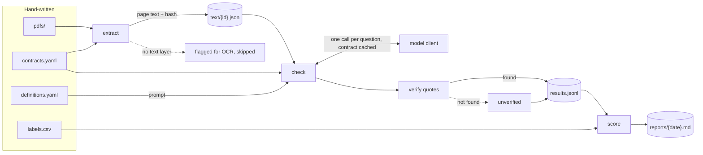

# Lite: the lightweight contract check

Tests Paper Trail's core idea on 20 to 30 public government AI contracts before scaling it up: **does the contract give the government the power to find out the system was wrong, and to do something about it?**

If it passes its decision point, the MVP runs this same check on hundreds of contracts and publishes the result. Its code moves into a shared package the MVP imports. See [mvp.md](mvp.md) for the MVP and [research.md](research.md) for the research and decision log.

**Out of scope:** search and embeddings, a database, the MCP server, connectors, the agent loop, a web interface.

## Questions and answers

Five questions per contract. The wording and what counts as each answer live in [`lite/definitions.yaml`](../lite/definitions.yaml) (version 2), never in prompts or code.

| Key | Asks whether the contract... |
| --- | --- |
| `know` | Obliges the vendor to document inputs, training data, testing and known limits |
| `show` | Lets the agency share that documentation, or its findings, publicly |
| `test` | Sets a required accuracy or error level, plus an audit or testing right |
| `act` | Ties consequences to failing requirements, and requires re-testing after model changes |
| `leave` | Keeps the government's data and what's built from it, and lets it switch vendors |

| Answer | Set by | Meaning |
| --- | --- | --- |
| `yes`, `partial`, `no` | Model, then verified | A quoted clause meets, partly meets, or rules out the definition |
| `silent` | Model, then checked | Every page was read and nothing addresses it |
| `incomplete` | Code | `silent`, but an incorporated document is missing |
| `unverified` | Code | The quote wasn't found on its page; manual review |
| `withheld`, `no_record` | `contracts.yaml` | From records requests; never sent to the model |

## System



Dashed lines are the safeguards: nothing unreadable reaches the model, and nothing unverified counts as evidence. `silence_log.csv` sits outside the pipeline: records-request outcomes reach results through each contract's `record_status` in `contracts.yaml`.

| Module | Does | Status |
| --- | --- | --- |
| `schemas.py`, `files.py` | Validate the hand-written files; one shared CSV loader | Merged |
| `extract.py` | Page-by-page text, file hash, scanned-PDF flag | Merged; `ptlite extract` command not wired yet |
| `verify.py` | `quote_on_page`: is this quote on this page? | Merged |
| `model.py` | `ModelClient`, `AnthropicClient`, `ask_with_retry` | Merged |
| `check.py` | Five questions per contract, verify, merge, record | Next |
| `score.py` | Compare results with labels; write the report | After `check` |

## How key pieces behave

**Verification** tolerates only what PDF extraction introduces: whitespace, line breaks, line-end hyphens (either reading), ligatures and curly quotes or dashes (Unicode NFKC plus a small table). Quotes under five words don't count.

```python
quote_on_page(
    "The Contractor shall provide a", page_text
)  # True across "Con-\ntractor"
quote_on_page("audit rights", page_text)  # False: too short to be evidence
```

**The model call** sends the contract first, marked for caching, then the question, so questions 2 to 5 reuse the cached contract. The model ID comes from `PTLITE_MODEL`. Unusable output is retried once, then recorded as an error, never as an answer.

```python
reply = ask_with_retry(client, system, contract_text, question)
if isinstance(reply, ModelOutputError):
    ...  # write an error row, not an answer
```

**Long contracts.** For the first release, a contract too long for one call is logged as skipped, not answered. Overlapping page windows come later; `silent` will then require every window to come back empty.

**Provenance.** Every `results.jsonl` line records the model that answered, prompt version, definitions version and timestamp.

## Evaluation

Hand labels in `labels.csv` are the gold set, written before looking at model output. Five or so contracts are labeled twice, a week apart, to check consistency.

| Metric | Measures |
| --- | --- |
| False-silent rate | Of real clauses you found, the share the model called `silent`. **The headline number** |
| False-yes rate | Of your `silent` or `no` labels, the share the model called `yes` |
| Agreement | Exact matches with your labels |
| Quote verification rate | Share of quoted answers that verify |
| Self-consistency | Your two labeling passes, compared |

Every rate is reported with its count and a 95% upper bound: 0 misses out of 40 means "under about 7%", not "0%". Federal contracts are reported separately.

**Decision point after L3:** fold this into the MVP only if the false-silent rate's upper bound is low enough to stand behind a `silent` finding in public.

## Milestones

| | Scope | Done when | Status |
| --- | --- | --- | --- |
| L0 | Schemas, `validate`, definitions | Files validate | Done |
| L1 | Extract, labels | 5 to 10 contracts extracted and labeled | Code merged; contracts and labels next |
| L2 | `check` | Every answer verified or flagged | Next |
| L3 | `score`, missed-clause test set | Report on 20+ contracts | Planned |
| L4 | Second reader, confidence scores | Only if the decision point passes | Planned |


## Later ML additions

- **Missed-clause test set (L3).** Delete or move a labeled clause in a copy of the contract and check the model notices. Turns 40 labeled clauses into thousands of test cases.
- **Second reader (L4, carried into MVP milestone 2).** Fine-tune a small open model to flag, per page, which questions the page addresses. `silent` requires both readers to find nothing.
- **Confidence scores (L4).** Ask each question several times; agreement becomes a confidence score, checked against labels for honesty (calibration).
