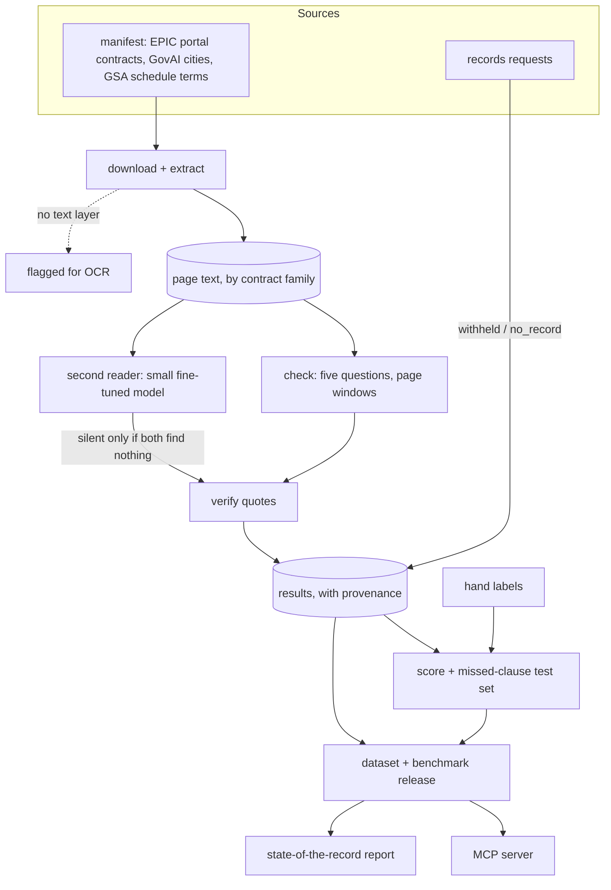

# MVP: contract accountability at scale

Takes the lite check from 20 to 30 contracts to hundreds, and publishes the result: a versioned dataset of what government AI contracts do and don't oblige vendors to do, a benchmark for detecting missing clauses, a tool any AI assistant can query, and a "state of the record" report.

It starts after the lite decision point passes. Milestone 0 can start once lite L2 is done. See [lite.md](lite.md) and [research.md](research.md).

**Why this scope.** Paper Trail's distinctive work is the contract check, silence treated as data, and a measured error rate for absence claims. General cited search over documents is common work, so it waits until after the MVP (see [Later](#later)).

**Non-goals:** search and embeddings, general Q&A over privacy assessments, audits and court records, the scorecard agent, connectors, a web app, legal conclusions.

## System



One pipeline, the lite check at scale. Everything published goes through quote verification and is reported with its measured error rate.

## What changes from lite

| Lite | MVP |
| --- | --- |
| `extract.py`, `verify.py`, `model.py`, `check.py` | Moved to a shared `papertrail/core/` package; lite imports it |
| Contracts that fit one call | Overlapping page windows; `silent` only if every window is empty |
| 20 to 30 contracts | Hundreds, starting from EPIC's 621-contract list |
| One model reads | A second, fine-tuned reader checks every `silent` |
| One labeler | A second labeler with legal or procurement background on a subset |
| Results in `results.jsonl` | A versioned public dataset with a datasheet |

## Components

**Corpus.** A manifest of contract families (master agreement, addenda, exhibits, amendments) with source URLs and how each was obtained. Records-request outcomes become `withheld` and `no_record` entries, so a refusal is a data point, not a gap.

```yaml
- id: ca-dgs-vendor-x-2024
  level: state
  state: CA
  family:
    - {role: master_agreement, pdf: pdfs/ca-msa.pdf}
    - {role: addendum, pdf: null}   # missing: blocks silent, answer becomes incomplete
```

**Check at scale.** The lite check with page windows. Runs go through the Message Batches API, which costs half as much and suits work nobody waits on. Every result records model, prompt version, definitions version and timestamp.

**Second reader.** A small open model fine-tuned to flag, page by page, which questions a page addresses. It's trained on verified quotes from contracts outside the labeled set, and scored only against hand labels. A `silent` answer stands only when both readers find nothing.

```python
if claude_answer == "silent" and reader_flags_page(contract, question):
    answer = "unverified"  # disagreement goes to manual review
```

**Evaluation.** Hand labels, a second labeler on a subset, and the missed-clause test set: labeled clauses deleted or moved in copies of contracts, so the false-silent rate is measured on thousands of cases. Results are reported by question, by level (federal, state, local) and by state.

**Dataset and benchmark release.** Contract metadata and source links, hand labels, model results with verified quotes and pages, silence statuses, and the missed-clause benchmark with a scoring script. A datasheet documents how contracts were chosen, labeled and checked, and the known limits. Before release: a review and dispute policy for named vendors and agencies.

**MCP server.** Read-only tools on the official MCP Python SDK: `list_contracts`, `check_contract`, `get_clause`. Descriptions tell the model what a `silent` answer means and what it doesn't.

```python
@mcp.tool()
def check_contract(contract_id: str) -> list[dict]:
    """The five accountability answers for one contract, each with its verified quote,
    or a silence status. 'silent' means the contract doesn't oblige it, not that no
    other rule does."""
    return results_for(contract_id)
```

**Report.** "State of the record": what share of contracts could be obtained, what share are silent on each question, and how that varies by state and level. Optionally, contract lineage: which states inherited which gaps from one NASPO master agreement.

## Milestones

Branches are named `mvp/<feature>`.

| # | Milestone | Branches | Done when |
| --- | --- | --- | --- |
| 0 | Shared core | `core-package`, `page-windows`, `ci` | Lite runs on `papertrail.core`; long contracts check correctly |
| 1 | Corpus | `manifest`, `download`, `families` | 100+ contracts extracted, families recorded, requests tracked |
| 2 | Check and measure at scale | `batch-runs`, `second-reader`, `perturb`, `score-by-group` | False-silent rate per question with a tight upper bound |
| 3 | Dataset and benchmark | `dataset-export`, `benchmark`, `datasheet` | Version 1 published, with a dispute policy in place |
| 4 | Access | `mcp-server`, `report` | An assistant answers from the tools; the report is out. **MVP complete** |

## Later

After the MVP, each only if the published dataset proves useful:

- **Cited Q&A over other records** (privacy impact assessments, audits, court filings): search, embeddings and verified citations.
- **Renewal alerts:** watch SAM.gov and state portals for solicitations and renewals, with the prior contract's gaps attached.
- **Scorecard agent:** drafts of the op-ed's four accountability questions per system, with human review.
- **A web interface** and hosted deployment.
